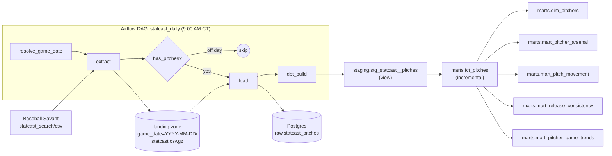
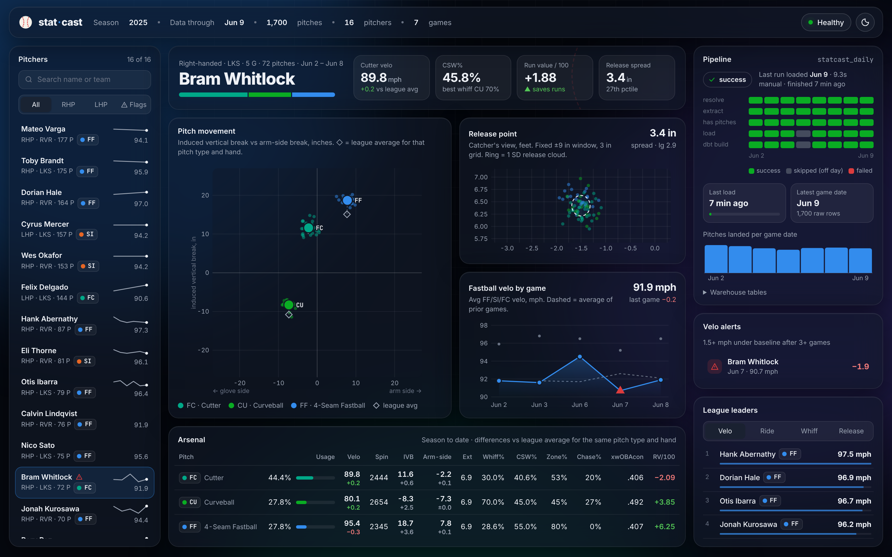

# stat-cast

A daily batch pipeline for MLB pitch-tracking data. Every morning Airflow pulls the previous day's pitch-level Statcast data from Baseball Savant, lands the raw file, loads it into Postgres, and runs dbt to rebuild tested pitcher models: arsenal, movement vs league, release consistency, and game-by-game velocity trends.

The same pipeline also runs on **Databricks** as a medallion lakehouse: Auto Loader into bronze Delta, `MERGE` into silver, the dbt marts ported to Spark SQL in gold, deployed as a bundle job on serverless. See [databricks/README.md](databricks/README.md).

It's the data engineering companion to [baseball-pitching-scout](https://github.com/st8991/baseball-pitching-scout), which studies one pitcher at a time from a local DuckDB file. This project is the shared, league-wide warehouse a tool like that would read from.



## Quick start

You need Docker. The stack runs offline by default on a synthetic sample week, so nothing depends on Savant being reachable.

```bash
docker compose up -d --build     # Postgres + Airflow 3, http://localhost:8080
make backfill                    # run the DAG once per day of the sample week
make psql                        # then query the marts
```

```sql
select pitcher_name, pitch_type, usage_pct, avg_velo_mph, avg_ivb_in, whiff_pct, csw_pct
from marts.mart_pitcher_arsenal
order by pitcher_name, usage_pct desc;
```

Then open the dashboard at **http://localhost:8050**.

To pull real data, set `STATCAST_SOURCE=savant` in `.env` (copy `.env.example`), restart, and unpause `statcast_daily` in the UI, or backfill a range:

```bash
docker compose exec airflow airflow backfill create --dag-id statcast_daily \
    --from-date 2025-04-01 --to-date 2025-04-07
```

Each run loads the game date before its logical date. To load one specific day, trigger the DAG with `{"game_date": "2025-06-01"}`.

### Without Docker

```bash
python -m venv .venv && source .venv/bin/activate
pip install -r requirements-dev.txt
export WAREHOUSE_HOST=localhost WAREHOUSE_PORT=5432          # any Postgres you can reach
PYTHONPATH=src python -m statcast_pipeline --source sample backfill --start 2025-06-02 --end 2025-06-09
DBT_PROFILES_DIR=dbt dbt build --project-dir dbt
pytest -q
```

## Dashboard



One screen over the warehouse and the pipeline that feeds it (`src/statcast_dashboard/`):

- **Pitchers**: searchable roster with a fastball-velo sparkline per pitcher and a flag on anyone with a velo drop.
- **Pitch movement**: every pitch by induced vertical break and arm-side break, with each pitch type's average linked to the league average for the same type and hand (`mart_pitch_movement`).
- **Release point**: the release cloud in a fixed ±9 in window with its 1 SD ellipse (`mart_release_consistency`), so spreads compare across pitchers.
- **Fastball velo by game**: each game against the average of prior games, with the 1.5 mph drop flag (`mart_pitcher_game_trends`).
- **Arsenal**: usage, velo, spin, movement vs league, whiff, CSW, zone, chase, xwOBA on contact and run value per 100 (`mart_pitcher_arsenal`).
- **Pipeline**: the last 14 `statcast_daily` runs task by task (off days show as skipped), time since the last load against the 36 h freshness threshold, pitches landed per game date and row counts for every table.
- **Velo alerts** and **league leaders** (velo, ride, whiff, tightest release). Click any name to open that pitcher.

It's a small read-only FastAPI app plus a buildless HTML/SVG frontend; there's nothing to compile. It reads the warehouse with the same `WAREHOUSE_*` settings as the loader. DAG runs come straight from Airflow's metadata database when `AIRFLOW_DB_DSN` is set (Docker Compose sets it); without it the pipeline panel still shows the warehouse side.

```bash
make dashboard            # against WAREHOUSE_* from your shell, http://localhost:8050
make dashboard-export     # dist/dashboard: the frontend + a JSON snapshot, for static hosting
```

The export writes the same `api/*.json` paths the live app serves, so the snapshot can go on GitHub Pages or any file host and look exactly like the live app did. Light and dark themes follow the OS, with a toggle in the top bar.

## How it works

### Ingest (`src/statcast_pipeline/`)

| Step | What it does |
|---|---|
| `extract.py` | One request per game date to Savant's CSV endpoint (regular season). Retries 429/5xx with exponential backoff. Savant caps a query at 25,000 rows; a full day is about 4,500 pitches, so hitting the cap means a truncated result and the task fails instead of loading a partial day. Writes `landing/game_date=YYYY-MM-DD/statcast.csv.gz` atomically. |
| `transform.py` | Conforms the frame to a fixed 45-column contract (`schema.py`). Savant's CSV has 100+ columns and keeps adding more (`arm_angle` arrived in 2024): unknown columns are dropped and logged, missing ones become NULL, numbers that won't parse become NULL, rows without a full key are dropped, repeated pitches keep the last version. |
| `load.py` | Replaces whole game dates in one transaction: `delete` the dates in the batch, then `COPY` the new rows, then write an audit row to `raw.ingestion_log`. Re-running a day or a range never double counts, and a failed load leaves the previous version in place. |

The full original CSV stays in the landing zone, so adding a column to the contract later is a reload from disk, not a re-download.

### Orchestrate (`dags/statcast_daily.py`)

Airflow 3 TaskFlow DAG. `has_pitches` short-circuits on off days so load and dbt are skipped, not failed. Tasks retry with exponential backoff, `max_active_runs=3` keeps backfills polite to Savant, and dbt runs from its own virtualenv in the image because its dependency pins conflict with Airflow's.

### Model (`dbt/`)

| Model | Grain | What's in it |
|---|---|---|
| `stg_statcast__pitches` | pitch | Renamed columns; movement in inches; **arm-side break** (horizontal break flipped for lefties, so positive always means arm-side run); outcome flags (`is_swing`, `is_whiff`, `is_csw`, `is_chase`, `is_in_zone`); run value from the pitcher's side. |
| `fct_pitches` | pitch | Incremental (`delete+insert` on `pitch_id`). Each run re-processes the last 3 game dates, because Savant revises pitch types and run values after the fact. |
| `dim_pitchers` | pitcher | Latest name, hand and team, first/last game, workload. |
| `mart_pitcher_arsenal` | season × pitcher × pitch type | Usage, velo, spin, IVB, arm-side break, extension, whiff%, CSW%, zone%, chase%, xwOBA on contact, run value per 100. |
| `mart_pitch_movement` | season × pitcher × pitch type | Velo and movement minus the league average for the same pitch type, hand and season, plus z-scores ("this four-seamer has +4 in of ride"). |
| `mart_release_consistency` | season × pitcher | Release point spread in inches, extension and arm-angle variability, and **tunneling**: distance between each secondary pitch's release centroid and the primary pitch's. |
| `mart_pitcher_game_trends` | pitcher × game | Fastball velo and release height against the pitcher's own prior-game baseline, with a flag for a 1.5+ mph drop after 3+ games. The morning-after view a performance staff would check. |

Tests: `unique`/`not_null`/`accepted_values`/`relationships` on keys, a **dbt unit test** that pins the arm-side sign convention and the swing/whiff/CSW/chase flags, and singular tests for implausible velocities, arsenal grain, usage summing past 100%, and every landed day reaching the fact table. Source freshness warns if no new pitches land for 36 hours (expected to warn in the off-season).

### Tests and CI

`pytest` covers the transform contract, retry and truncation logic, off-day handling, load idempotency against a real Postgres (each test runs in a throwaway schema; skipped when no database is reachable), and DAG integrity (no import errors, expected task graph, retries on every task). GitHub Actions runs ruff, pytest, the sample backfill and `dbt build` twice (full, then incremental) against a Postgres service, plus the DAG checks in a separate Airflow job and the Databricks transforms on PySpark 3.5 and 4.0.

## The sample data is synthetic

`data/sample/statcast_sample.csv.gz` is generated by `scripts/make_sample.py` (deterministic, byte-identical on every run). It has Statcast's column names and plausible distributions for 16 fictional pitchers on two fictional teams over one week, including an off day, a repeated row and Savant's stray `pitcher.1` column so the loader's edge cases get exercised. **Its numbers describe no real player.** Real analysis needs `STATCAST_SOURCE=savant`.

## Layout

```
dags/statcast_daily.py           Airflow DAG
src/statcast_pipeline/           extract, transform, load, CLI
dbt/models/staging/              source definition, staging view, unit test
dbt/models/marts/                fact, dimension and pitcher marts
dbt/tests/                       singular data tests
dbt/analyses/                    example queries
scripts/make_sample.py           synthetic sample generator
tests/                           pytest suites (tests/lakehouse: PySpark)
databricks.yml, databricks/      Databricks bundle, job and notebooks
src/statcast_lakehouse/          bronze, silver, gold and checks for Databricks
src/statcast_dashboard/          dashboard API, static export and frontend (static/)
docker-compose.yml, Dockerfile   local Postgres + Airflow 3 + dashboard stack
.github/workflows/ci.yml         lint, tests, dbt build, DAG checks, Spark tests
```

## Known limits and next steps

- **Savant rate limits.** One request per day per run is gentle, but a full-season backfill is ~190 requests; keep `max_active_runs` low.
- **Regular season only.** Postseason and spring training are a parameter change in `extract.GAME_TYPES`.
- **Statcast data belongs to MLB.** Use it for personal research; don't redistribute pulled data.
- Natural next steps: partition `raw.statcast_pitches` by season, add batter-side marts (swing decisions, bat tracking), publish dbt docs, and point PitchScout's data layer at this warehouse.
