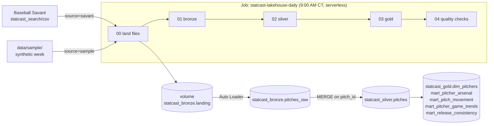

# Databricks lakehouse

MLB pitch-tracking data on Databricks, built as a medallion pipeline: raw daily Statcast files land in a Unity Catalog volume, Auto Loader ingests them into a bronze Delta table, a typed and de-duplicated silver table is kept up to date with `MERGE`, and gold rebuilds pitcher-level marts (arsenal, movement vs league, release consistency, game-by-game velocity trends). A Declarative Automation Bundle deploys it as one daily job on serverless compute, and quality checks fail the job if the data breaks a rule.

It runs beside the Airflow + Postgres + dbt pipeline in this repo and shares its pieces: the Savant client (`statcast_pipeline.extract`), the column contract (`statcast_pipeline.schema`) and the sample week. The dbt models and tests were ported to Spark SQL, so both warehouses build the same marts from the same data.



## Run it in Databricks

Everything defaults to the `workspace` catalog and the synthetic sample week committed in `data/sample/`, so it runs on a fresh workspace (Free Edition included) with no network access.

**Notebooks, one at a time** (quickest way to see it work):

1. In your workspace, open the stat-cast Git folder and pull (or switch to the branch with `databricks/`).
2. Open `databricks/notebooks/` and run `00_setup_and_land`, `01_bronze`, `02_silver`, `03_gold`, `04_quality_checks` in order on serverless compute.
3. Query the results:

   ```sql
   SELECT pitcher_name, pitch_type, usage_pct, avg_velo_mph, avg_ivb_in, whiff_pct, csw_pct
   FROM workspace.statcast_gold.mart_pitcher_arsenal
   ORDER BY pitcher_name, usage_pct DESC;
   ```

**As a job** (the way it's meant to run):

- In the workspace: open `databricks.yml` at the top of the stat-cast Git folder, open the Deployments panel (rocket icon), click **Deploy**, then **Run** on `statcast-lakehouse-daily`.
- Or from a terminal with the [Databricks CLI](https://docs.databricks.com/aws/en/dev-tools/cli/install):

  ```bash
  databricks auth login          # once; the host comes from your profile, not this repo
  databricks bundle validate
  databricks bundle deploy       # dev target: names prefixed with [dev you], schedule paused
  databricks bundle run statcast_daily
  ```

**Real data:** run the job (or notebook 00) with `source = savant`, plus `start_date` / `end_date` for a backfill. With both empty (the daily run) it re-pulls the last `refresh_days` days ending yesterday so Savant's corrections land, and skips Savant entirely in the off-season. Your compute needs outbound internet access to `baseballsavant.mlb.com`.

| Job parameter | Default | Meaning |
|---|---|---|
| `catalog` | `workspace` | Catalog for the three schemas and the volume |
| `source` | `sample` | `sample` replays the committed week; `savant` pulls live data |
| `start_date`, `end_date` | empty | Savant backfill range, `YYYY-MM-DD`; days already landed are skipped |
| `game_types` | `regular` | Comma-separated: `regular`, `postseason`, `spring` |
| `refresh_days` | `3` | Daily runs (no dates) re-pull this many trailing days |
| `full_refresh` | `false` | Rebuild silver from all of bronze instead of only new rows |
| `min_pitches` | `10` | Pitch types thrown fewer times are left out of the marts |

## How it works

| Layer | Notebook | What it does |
|---|---|---|
| Landing | `00_setup_and_land` | Creates the schemas and volume, then writes one raw CSV per game date (`statcast_YYYY-MM-DD.csv.gz`). Live pulls use the same Savant client as the Airflow DAG. Writes to a temp name and renames, so a half-written file never looks landed. The daily run re-pulls the trailing `refresh_days`; a day whose data changed lands as a new version (`statcast_YYYY-MM-DD__<pull time>.csv.gz`, since Auto Loader reads each file name once) and an unchanged one isn't landed again. Backfill ranges skip days already landed. Off-season daily runs don't call Savant. Savant caps a query at 25,000 rows, so a day that hits the cap fails instead of landing partial data. |
| Bronze | `01_bronze` | Auto Loader with `availableNow`: only new files are read, every column stays a string, and each row records its source file and ingest time. Header names are made Delta-safe (`pitcher.1` becomes `pitcher_1`). When Savant adds a column, Auto Loader evolves the schema and the task's retry picks it up. |
| Silver | `02_silver` | Types the loader's 45-column contract (values that won't parse become NULL, not errors), drops rows without a full key or without tracking, keeps the newest version of a re-issued pitch, converts movement to inches, adds arm-side break and swing/whiff/CSW/chase flags. `MERGE` on `pitch_id`, so re-landing a corrected day updates rows instead of duplicating them. Liquid clustered on `game_date, pitcher_id`. |
| Gold | `03_gold` | Rebuilds five tables from silver with Spark SQL ported from the stat-cast dbt models. |
| Checks | `04_quality_checks` | The stat-cast dbt tests as queries: unique keys, valid hand, usage shares at most 1, plausible velocity, every tracked bronze date reaching silver. Any failure fails the job. |

The logic lives in `src/statcast_lakehouse/` as plain functions on DataFrames; the notebooks only read and write tables. That keeps the transforms testable without a workspace.

## Tests

```bash
pip install -r requirements-lakehouse.txt   # needs Java 17+
pytest -q tests/lakehouse
```

The tests run the real transforms on the sample week with a local SparkSession: typing and de-duplication, movement sign conventions, outcome flags, every mart building, and every quality check passing (plus a check that a duplicate pitch is caught). GitHub Actions runs them on PySpark 3.5 and 4.0 as the `lakehouse` job in `ci.yml`.

## Layout

```
databricks.yml                   bundle (repo root, so notebooks can import src/): dev and prod targets
databricks/resources/            the daily job
databricks/notebooks/            00-04 pipeline steps, _common for parameters
src/statcast_lakehouse/          bronze, silver, gold, quality checks
tests/lakehouse/                 PySpark tests on the sample week
```

## Notes

- The sample data is the same synthetic week the Airflow pipeline uses; its numbers describe no real player.
- Gold is a full rebuild each run. The marts are small; if they grow, `mart_pitcher_game_trends` is the first candidate for an incremental `MERGE` by game date.
- A corrected day updates or adds pitches in silver, but a pitch Savant removes in a correction stays in silver (the Postgres pipeline replaces whole days, so it drops them). Removals are rare; `full_refresh` doesn't fix it either because bronze keeps every version.
